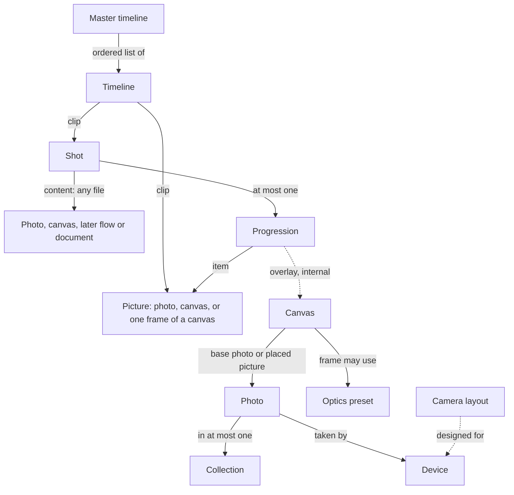

# The model so far

The decisions of workshops 00–09 and the [interjection](i1-interjection.md) in one picture. This page decides nothing; where it differs from a workshop page, the workshop page is right. Updated 2026-11-20.

## How things reference each other

An arrow means "points at". Nothing points at a collection, and a photo points at nothing but its collection and its device.

## Files

Everything a user makes is a file ([07](07-organisation.md)). A file belongs to one root (a project, or an account home), sits in one container (a folder or, for photos, a collection) and has properties: the fixed system ones (name, type, created, updated, created by), the facts of its type, those an app provides, and whatever the project defines.

| File type | What it is | Holds | Decided in |
| --- | --- | --- | --- |
| Photo | A still image; the untouched original plus a preview and a thumbnail | Nothing; facts: size, time taken, angle of view, device, EXIF, the frame on screen at capture | [01](01-media.md), [02](02-optics.md), [03](03-capture.md) |
| Canvas | A blank surface or a base photo with drawing and adjustment layers, placed pictures and frames | Layers, objects, frames; a render | [05](05-composition.md) |
| Shot | An intent: a planned picture | A content list (any files) and optionally one progression | [04](04-shots.md) |
| Timeline | A rough cut for deciding | Clips (picture, shot, placeholder) and chapter markers | [06](06-timeline.md) |
| Master timeline | The project's one order of timelines | An ordered list of timelines | [06](06-timeline.md) |

## More file types

| File type | What it is | Root | Decided in |
| --- | --- | --- | --- |
| Folder | Contains any files; nests | Project or account home | [07](07-organisation.md) |
| Collection | Contains only photos; a photo is in at most one | Project | [I1](i1-interjection.md), [07](07-organisation.md) |
| Filter | A saved query over files | Project | [07](07-organisation.md) |
| Optics preset | Format, multiplier, squeeze, delivery aspect and lenses; changes additively only | Project | [02](02-optics.md) |
| Property definition | A property defined once and attached to file types | Project, Settings folder | [04](04-shots.md), [07](07-organisation.md) |
| Naming pattern | How new files of a type are named | Project, Settings folder | [04](04-shots.md) |
| Device | Any registered hardware, with a type: phone and tablet in the core; light, battery, camera, video transmitter from the Hardware extension | Account home | [03](03-capture.md), [08](08-extensions.md) |
| Flow (extension) | A timed programme that drives the controls of devices | Project | [08](08-extensions.md) |
| Camera layout | Which controls the camera screen shows, and where | Account home | [03](03-capture.md) |

## Rules that hold everywhere

- **References, not ownership.** A removed file leaves a missing reference; it never breaks the thing that pointed at it. The one exception is an internal file, which lives and dies with its parent.
- **Nothing is stored on a reference.** A shot's entry, a progression's item and a timeline's clip are a pointer (plus a hold time where time matters). What a picture looks like is the file's business. The bounded exception is a progression's overlay and default frame.
- **Frames live inside a canvas.** A frame is free-form, from an optics preset, or an aspect ratio.
- **A photo's angle of view** comes from its EXIF; the live picture's from what the camera reports. Real lenses only, no digital zoom.
- **View modes** (Mask, Outline, Crop, Full) are a window's choice, never stored.
- **A render per canvas** is what viewers without a drawing engine show; there are no bakes.
- **One editor at a time** for a canvas and a timeline.
- **Apps are hosted:** a file's app offers a viewer, an editor and an inspector that another app (a timeline, a shot window) mounts in place.
- **Both shells are composed from one app catalogue** ([09](09-shells.md)): the Studio as a desktop with windows; the phone and tablet app with tabs the person chooses per device. Preferences follow the account.
- **Extensions plug in at fixed points** (file types, device types, apps, properties, camera controls, a channel on the one phone link, sync tasks); the core never imports them.
- **Hard project scope.** No file moves or is shared between projects. Files in an account home follow the person.
- **The bin** restores a file everywhere it was used.
- **One file browser** with search, saved filters, and list, grid and board views.

## Tiers

| Tier | What |
| --- | --- |
| Core | Media (photos, collections), capture, the angle of view and optics math, shots, properties, the canvas, the filesystem (folders, bin, filters), the shells |
| Standard apps | Optics presets, timeline and master timeline, camera layouts |
| Extensions | Hardware (a catalogue of brands, models and types; pairing; the phone as proxy; live picture as a feed) and Flows; enabled per project |

## Not in the base

Locations, spots, maps, GPS and positions (places workshop, #352), review states, fixed tags, rigs and equipment, vignetting, steps, bakes, clip-owned edits, day planning, digital zoom, capturing into a shot (deferred).

## Still open

- **09a:** places (Motiv, address, geography), [#352](https://github.com/OpenClapper-dev/core/issues/352).
- **UX workshops**, then **10**.
