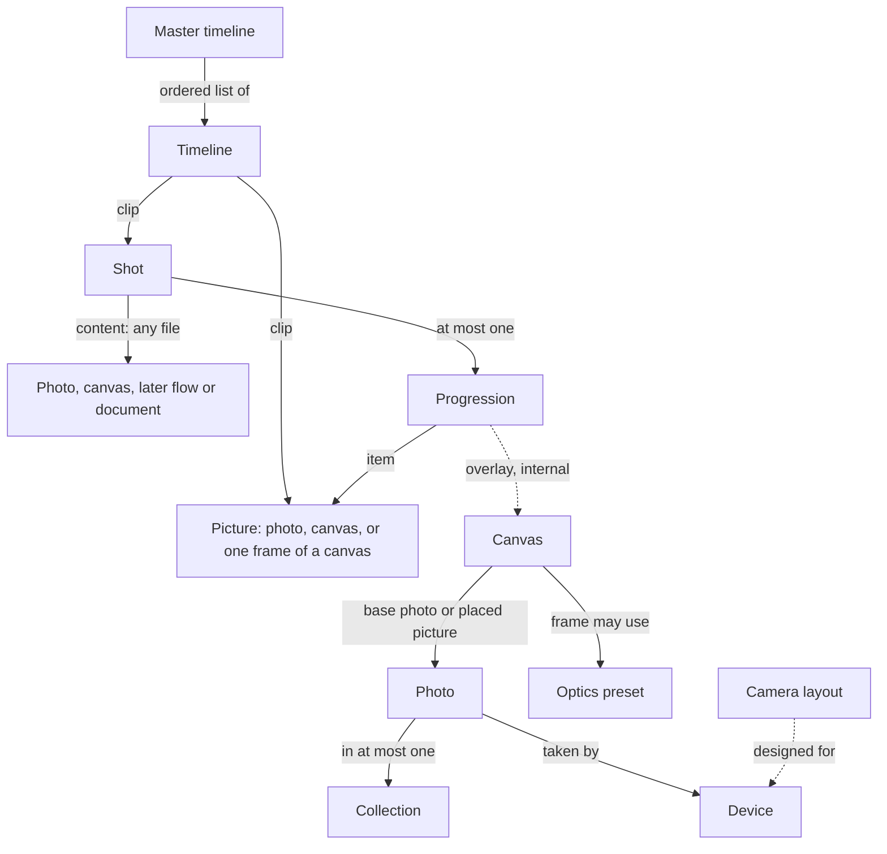

# The model so far

The decisions of workshops 00–06 and the [interjection](i1-interjection.md) in one picture. This page decides nothing; where it differs from a workshop page, the workshop page is right. Updated 2026-11-19.

## How things reference each other

An arrow means "points at". Nothing points at a collection, and a photo points at nothing but its collection and its device.

## Files

A file belongs to exactly one project and has properties: the fixed system ones (name, type, created, updated, created by), the facts of its type, and whatever the project defines.

| File type | What it is | Holds | Decided in |
| --- | --- | --- | --- |
| Photo | A still image; the untouched original plus a preview and a thumbnail | Nothing; facts: size, time taken, angle of view, device, EXIF, the frame on screen at capture | [01](01-media.md), [02](02-optics.md), [03](03-capture.md) |
| Canvas | A blank surface or a base photo with drawing and adjustment layers, placed pictures and frames | Layers, objects, frames; a render | [05](05-composition.md) |
| Shot | An intent: a planned picture | A content list (any files) and optionally one progression | [04](04-shots.md) |
| Timeline | A rough cut for deciding | Clips (picture, shot, placeholder) and chapter markers | [06](06-timeline.md) |
| Master timeline | The project's one order of timelines | An ordered list of timelines | [06](06-timeline.md) |

## Other objects

| Object | What it is | Belongs to | Decided in |
| --- | --- | --- | --- |
| Collection | Photos that belong together; a photo is in at most one | Project | [I1](i1-interjection.md) |
| Optics preset | Format, multiplier, squeeze, delivery aspect and lenses; changes additively only | Project | [02](02-optics.md) |
| Property definition | A property defined once and attached to file types | Project | [04](04-shots.md) |
| Naming pattern | How new files of a type are named | Project | [04](04-shots.md) |
| Device | A phone or tablet (later other cameras), registered automatically | Account | [03](03-capture.md) |
| Camera layout | Which controls the camera screen shows, and where | Account | [03](03-capture.md) |

Whether these are files in the filesystem is workshop 07.

## Rules that hold everywhere

- **References, not ownership.** A removed file leaves a missing reference; it never breaks the thing that pointed at it. The one exception is an internal file, which lives and dies with its parent.
- **Nothing is stored on a reference.** A shot's entry, a progression's item and a timeline's clip are a pointer (plus a hold time where time matters). What a picture looks like is the file's business. The bounded exception is a progression's overlay and default frame.
- **Frames live inside a canvas.** A frame is free-form, from an optics preset, or an aspect ratio.
- **A photo's angle of view** comes from its EXIF; the live picture's from what the camera reports. Real lenses only, no digital zoom.
- **View modes** (Mask, Outline, Crop, Full) are a window's choice, never stored.
- **A render per canvas** is what viewers without a drawing engine show; there are no bakes.
- **One editor at a time** for a canvas and a timeline.
- **Apps are hosted:** a file's app offers a viewer, an editor and an inspector that another app (a timeline, a shot window) mounts in place.
- **Hard project scope.** No file moves or is shared between projects.

## Tiers

| Tier | What |
| --- | --- |
| Core | Media (photos, collections), capture, the angle of view and optics math, shots, properties, the canvas, the shells |
| Standard apps | Optics presets, timeline and master timeline, camera layouts |
| Extensions | Lights, flows, camera control, live picture (workshop 08) |

## Not in the base

GPS and positions, review states, fixed tags, rigs and equipment, vignetting, steps, bakes, clip-owned edits, day planning, digital zoom, capturing into a shot (deferred).

## Still open

- **07:** the filesystem (which objects are files, folders, the bin, internal files, collection versus folder), the property catalogue and default templates, naming patterns, locations, filters.
- **08:** extensions.
- **09:** the shells, the app catalogue, the hosting mechanism in detail, the phone's and tablet's screens.
- **UX workshops**, then **10**.
